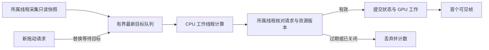

# 特效逐对象性能检测与关键优化计划

2026-10-19 最新要求：用户已要求备份后重写，并明确兼容当前文件。当前范围、功能保留和兼容验收以[特效重写需求](photon-rewrite-requirements.md)为准；下文保留原测量规格和历史实施状态，不把旧工具进度计作新实现完成。

编写日期：2026-10-19。状态：用户已授权完整实施；采样接入、工具界面与指挥家鼠标链已有运行证据，首项能力查询优化已做局部对照；完整验收与关键优化仍未完成。

初版按源码只读调查与 Markdown 计划编写完成。后续目标为“开始执行”，已新增[底层记录器](../../src/main/java/org/unitego/lobecorp/util/photon/performance/PhotonPerformanceTraceUtil.java)与[八项专项测试](../../src/test/java/org/unitego/lobecorp/util/photon/performance/PhotonPerformanceTraceUtilTest.java)，尚未接入游戏、模型、动画或时间轴调用。

上述为初期状态记录。用户后续明确选择 A，授权冲突已解决。当前采样已接入对象、模型、动画、时间轴和指挥链；面板、帧图/区间分析、GPU 批次/Bloom 与容量截断已接入并完成部分运行检查，完整编译/Data 已成功。本轮底层 23/23、导出 3/3、区间 11/11、后台任务 3/3 通过；动画 frame、命名标签与双向上下文已部分运行验收，另有汇总动画自测查询失败，未计通过；原生合成帧图输入、GPU 页、模式重置和屏幕关闭已有功能证据。选定实例/子树的采样控制、完整冷热/真实时间轴交互、开销校准和进一步关键优化仍未完成。能力查询和同点 seek 的首项优化仅有局部前后证据，不作为最终性能验收。逐项状态见[工具状态](photon-performance-tool.md)与[修改记录](changes.md)，不能将源码、菜单 fixture 或专项测试替代完整验收。

## 1. 目标与优先级

首先解决两个具体问题：

1. 指挥家手动触发激光时出现停顿，连续施放多次后才趋于正常。
2. 编辑器拖动时间轴明显卡顿，需要区分播放头定位、关键帧/片段拖动和时间轴滚动。

检测工具必须回答：哪个特效实例、哪个子对象、哪份模型、哪个部件/材质、哪个动画/轨道，在什么时刻、哪个线程、执行哪一步时耗费了多少时间；是否产生分配、资源加载、编译、重放、等待或共享渲染开销。

实施顺序为：补齐测量与归属 → 完整复现两条问题链路 → 对长帧排序 → 每次只实施一个有证据的优化 →
用相同场景重新测量。优先解决首次和交互停顿，再处理稳态吞吐。

最终交付应包含：可交互的性能面板、逐帧原始记录、逐对象排行榜、CPU/GPU 时间线、冷启动与预热对照、问题与优化证据表。不能只交付平均
FPS 或一张聚合火焰图。

## 2. 已核对的现状与证据边界

本轮通过 IDEA 读取项目源码、锁定依赖、相关系统文档和依赖源码。当前锁定环境为 Minecraft 26.1.2、NeoForge 26.1.2.100、Java
25、Photon 26.1.2.3、LDLib2 26.1.2.42、KilaGraph 26.1.0.15、GeckoLib 5.5.2。

| 当前入口                   | 已有能力                                                                                | 本次需求仍缺少的证据                                 |
|----------------------------|-----------------------------------------------------------------------------------------|------------------------------------------------------|
| PhotonFrameCapture         | 帧间隔、render CPU/GPU、渲染线程分配差、阶段和环境；最多 131072 帧、64 阶段、10～120 秒 | 逐对象归属、加载/提取细分、手动输入与拖动请求关联    |
| QueenBeamPerformanceTrial  | 通过 IEntitySkillAccess 直接施放真实 LaserSkill；登记服务端施放与客户端阶段             | 绕过了指挥家完整输入/CAST 路径，不能代替手动触发测试 |
| QueenBeamAllocationCapture | 显式 JFR 分配采样、GC 与编译事件                                                        | 分配样本权重不是每个特效对象的精确分配量             |
| 普通特效时间轴             | FXTimelineView.scrubTo 已调用 requestSimulateTo；同帧仅保留最新请求                     | 合并后的一次模拟到底有多重、排队多久、何时显示       |
| 原生 SceneView.simulateTo  | 前进补差量 tick；目标小于或等于当前时间时 reset、emit 并从零重放                        | 重置、复制、重放中各对象的实际耗时                   |
| 原生 runSimulationTicks    | 已有 fast simulation；末两 tick 完整更新；执行上限为 10000 tick                         | 快速路径命中、完整更新比例与上限截断情况             |
| 模型时间轴                 | scrub → seekPreview → PhotonModelSceneController.seek → 直接 simulateTo                 | 高频请求是否多次同步重放；清姿态和 Morph 更新的成本  |
| 模型与激光准备             | 已有模型 CPU 资产/拓扑准备、未发射实例、管线缓存和 Bloom 复用                           | 真实手动施放时是否就绪、是否命中、未命中的原因       |

上述都是实现路径核对，不是本轮运行复现。普通时间轴已经合并请求、模拟已有快速路径，不能再把“加入请求合并/快速模拟”直接当作缺失能力。

历史[释放实测](laser-release-profile.md)记载：普通 Run 首次释放最长帧 60.93 ms，从蓄力入口到释放后的完整窗口最长帧 120.94
ms；第三次释放仍有 16.97 ms 单帧。这说明既有记录尚未证明首次和完整施放达到稳定目标；这些数值不是本轮重新测量结果，也不能代表指挥家手动触发。

历史实现还有限量 16 份未发射实例、图管线描述缓存和当前分辨率约 39 MiB 的 Bloom 保留成本。后续必须核对当前实际容量、命中和内存，不能默认增大缓存就是收益。

## 3. “每个特效占多少性能”的统计口径

### 3.1 归属层级

按以下层级展示，并支持按实例和按资源两种聚合：

- 场景：世界或编辑器，具体会话与视口。
- 特效定义：资源 ID、内容版本；同一资源的多个实例可汇总。
- 特效运行实例：本次播放 ID、父实例、来源实体或编辑器项目。
- 特效对象：定义 UUID、实例代次、层级路径、类型；包含子发射器、Beam、Trail、模型、普通粒子等实际类型。
- 模型：资产 ID/版本、部件、材质分组、几何准备和动态姿态。
- 动画：播放实例、命名动画/模型片段/实体代码动画、轨道与片段，包含父子调用关系。
- 操作阶段：加载、准备、蓄力、输出、结束、清理、定位、重放、绘制。
- 帧与区间：真实墙钟时间、游戏 tick、特效局部时间、动画局部时间分别保存。

普通粒子默认按所属发射器聚合，不给每颗粒子常驻一个计时对象。选择某个发射器后，才在短时详细捕获中细分其更新模块或抽样粒子。

### 3.2 时间、内存和百分比必须分开

| 指标         | 含义                                                | 不得混同                                  |
|--------------|-----------------------------------------------------|-------------------------------------------|
| 墙钟耗时     | 方法/阶段开始到结束的经过时间，可能含等待、抢占、GC | 活跃 CPU 时间                             |
| 线程 CPU     | 支持时在选定粗粒度作用域读取线程 CPU 差             | 整机 CPU 占用率、所有对象的无开销精确时间 |
| GPU 区间     | 设备实际执行指定绘制区间的时间                      | Java draw 调用耗时、完整显示延迟          |
| 分配字节     | 同线程作用域的分配计数差，标为近似值                | 对象存活内存、进程内存、显存              |
| JFR 分配权重 | 抽样分配栈所代表的统计字节                          | 每个对象的精确字节数                      |
| 原生/显存    | 工具实际持有缓冲的容量、纹理/目标格式推算量         | 驱动内部的精确逐对象显存                  |
| 输入到画面   | 输入事件到包含目标状态的渲染帧/提交帧               | 液晶屏幕实际出光时间                      |
| 动画长度     | tick/局部时间的播放范围                             | 执行该动画所花费的 CPU/GPU 时间           |

整帧间隔沿用相邻 GameRenderer.render 入口的定义。现有 GPU 测量只覆盖 GameRenderer.render，排除
tick、extract、present、swap、limiter；新增更细范围后逐项命名，不能把不同口径的数据混成一列。

百分比必须标注分母，例如“占本帧 render-thread 已归属 self 耗时”或“占本次 seek
重放耗时”。CPU、GPU、跨线程任务和等待不直接相加。未归属时间单独展示，不能平均分配给所有特效。

## 4. 采样器架构与运行模式

扩展现有 performance 采样入口和生命周期，保留原整帧数据；使用同一会话关联对象、阶段和导出，不新增一套互不相关的帧时钟。具体新增类型和公开成员在实施时再经
IDEA 核对确定。

| 模式           | 采集范围                                            | 用途                         |
|----------------|-----------------------------------------------------|------------------------------|
| 关闭           | 一次快速开关判断，不做对象遍历、字符串拼接或导出    | 正式日常运行                 |
| 概览           | 帧、主要阶段、实例/对象计数、粗粒度聚合、缓存统计   | 长时间观察、发现长帧         |
| 对象详细捕获   | 短时记录指定实例/子树的对象、模型、动画和 seek span | 定位具体开销                 |
| GPU 详细捕获   | 限定 pass/批次的异步设备计时，可选择少量对象        | 区分提交等待、几何和像素负载 |
| JFR/Spark 辅助 | 单独开启，与同一会话的时间标记对齐                  | 分配、GC、编译及执行栈定位   |

概览、详细、GPU、JFR/Spark 的记录分别标记，不把高开销诊断成绩当作无采样器基准。

采集器放在被测调用外围，支持异常结束和嵌套恢复。采样故障只能将本条数据标为无效，不能吞掉原业务异常、改变技能结果或暂停游戏。

长帧触发模式保存已启用模式下的前置环形记录和后置窗口。只开启概览时，不能声称事后恢复了没有记录过的逐对象调用栈。

## 5. 逐对象检测清单

| 检测对象        | 必须拆分的阶段                                                  | 同时记录的数量与状态                             |
|-----------------|-----------------------------------------------------------------|--------------------------------------------------|
| FX 定义/运行态  | 读取、NBT/JSON 解码、校验、复制、建树、reset、emit、destroy     | 子实例数、复制字节、资产/版本、缓存结果          |
| 发射器与子对象  | 激活判定、参数计算、生成、粒子更新、子实例推进、移除            | 活动/可见/被剔除/降级状态，出生/存活/销毁数量    |
| Beam/Trail/碰撞 | 锚点、端点/截断、路径更新、碰撞、网格生成                       | 路径点、射线次数、顶点、索引                     |
| 命名/嵌套动画   | 所有权扫描、轨道遍历、曲线/表达式求值、混合、应用、事件         | 实际播放数、轨道/键数、HOLD/mute/遮蔽、跨界事件  |
| 模型动画        | 片段采样、部件/骨骼 TRS、Morph、蒙皮、姿态应用                  | 动态部件、骨骼、形状键、更新/复用次数            |
| 实体代码动画    | 客户端曲线、瞄准姿态合成、基础控制器、混合和骨骼写入            | 当前阶段、近远档、真实求值频率与缓存命中         |
| 模型资产/几何   | 解码/校验、准备拓扑、姿态、法线、三角化/剔除、分组网格          | 输入/输出三角形、引用顶点、材质组、准备/姿态命中 |
| 材质与资源      | 资源查找、参数解析、材质副本、纹理解码/上传、管线创建           | 源/版本、纹理尺寸、命中/失效原因、创建次数       |
| CPU 提交        | 提取、排序、writeMesh、缓冲借还、上传、UBO、FBO/fence           | draw/batch、提交字节、缓冲容量、绑定/同步次数    |
| GPU pass        | 特效批次、Bloom 各级、合成、编辑器预览目标                      | 视口/目标尺寸、采样覆盖、共享所有者、查询状态    |
| 编辑器 UI       | 输入分发、命中、hover/样式、布局、轨道重建、曲线/标尺、GUI sort | 事件数、控件/图元/可见轨道数、重建/失效原因      |
| 清理与后台      | 实例释放、缓存驱逐、资源释放、导出队列                          | 仍持有数、借出数、释放线程、积压和丢样           |

既有缓存命中不能只计总次数。至少记录“本次操作命中/未命中、准备成本、消费成本、清理/失效原因”，才能解释第几次操作才正常。

## 6. 身份、时间与正确归因

### 6.1 最小数据字段

| 字段组    | 计划字段                                                                                 |
|-----------|------------------------------------------------------------------------------------------|
| 会话      | session_id、schema_version、模式、代码状态、资源指纹、环境指纹                           |
| 因果关系  | operation_id、request_id、parent_request_id、cast_cycle、seek_sequence、关联可信度       |
| 实例      | effect_id、runtime_id、runtime_generation、parent_runtime_id、owner_entity_id/project_id |
| 对象      | object_definition_uuid、object_runtime_id、父对象、类型、名字、完整层级路径              |
| 模型/动画 | asset_id/revision、part_id、material_group、animation_id、playback_id、track_id、clip_id |
| 时间      | client_frame_id、server_tick、thread_id、start_ns、end_ns、游戏/局部时间、小数 tick      |
| 作用域    | span_id、parent_span_id、阶段、计时来源、inclusive_ns、self_ns                           |
| 计数      | 调用/更新/跳过、顶点/三角形/draw、分配近似值、缓存/准备结果                              |
| 有效性    | measured/sampled/shared/estimated/unavailable、丢样/截断、异常、GPU 回收状态             |

标识符只是方案字段，不是本轮新增的 API 或资源 ID。采集会话内使用数字索引，名字和路径放入有界字典；热路径不反复构建完整路径、序列化资产或计算内容哈希。

reset、循环重启和同 UUID 替换必须区分运行代次。记录只保存必要元数据，不长期强引用实体、FXRuntime、编辑器或 GPU
资源；对象销毁后仍能通过快照查看历史归属。

### 6.2 inclusive 与 self

同一线程、同步且正确嵌套的 span：

- inclusive = 结束时间 − 开始时间。
- self = inclusive − 直接子 span 覆盖区间的并集长度。
- 父对象包含子对象的时间不能再作为“对象总成本”重复相加。
- 动画求值若发生在模型采样内部，记在原嵌套树并以关联字段支持交叉筛选，不能在两个排行榜重复计入合计。
- 异步任务单独成轨，用因果箭头关联；等待在原线程记录，不从父级 self 中扣除另一线程的执行时间。
- 没有测到的时间保留未归属；异常栈、丢样或不完整 span 明确作废，不静默修成零。

资源级排行汇总同资源不同实例的 self；实例级保留每次播放、子实例和阶段，避免热实例掩盖首个实例。

分配计数的支持/启用状态必须检查；线程分配本身是近似量，且不包含原生内存和
GPU，依据 [Java 25 ThreadMXBean](https://docs.oracle.com/en/java/javase/25/docs/api/jdk.management/com/sun/management/ThreadMXBean.html)。

## 7. 指挥家手动激光的完整检测链

### 7.1 埋点范围

覆盖两个实际 CAST 入口：ConductorControls.castFacing，以及目标选择后 sendTarget 的 CAST 分支；随后跟踪
ConductorManualSkillControl 的手动 AIM/END 会话。不能只在客户端收到 OUTPUT 时开始采样。

链路为：真实点击/快捷键 → HUD/瞄准与单位选择 → CAST 发出 → 服务端接收与排队 → 指挥资格和转向等待 → 技能 cast 结果 →
蓄力 → 释放 → 同步接收 → 客户端动画/FX 创建 → 首次几何提取/提交 → 首个目标阶段画面 → 持续 → 结束/清理。

每个阶段同时记录时间标记和本线程实际工作。转向等待、注册前摇和冷却属于正常规则，单独显示；不将其删掉，也不将它们的持续时间直接称为卡顿。

服务端还需读取技能推进、命中/射线和 tick 成本，区分“帧停顿”和“指令/服务器响应慢”。拒绝、冷却未到、目标无效与未收到开始同步都保留结果。

### 7.2 关联与时钟边界

单机先用客户端操作、单位 UUID、技能运行实例/动画 UUID、阶段与顺序建立关联，保存关联依据和歧义。优先复用既有标识；不为首版诊断擅自新增业务网络包或修改协议。

同 JVM 的单调时钟可关联线程；独立客户端和服务器的 nanoTime 原点不可相减。远程场景分别报告本地分段与客户端输入到客户端画面总延迟，时钟映射或精确
request ID 穿透不足时明确标为推断，后续单独设计诊断扩展。

### 7.3 专门解释“多次才正常”

每次施放登记本进程第几次、本世界第几次、本资源/管线首次使用、距离上次的时间、准备是否完成，以及未发射实例的剩余/命中/失效。

重点观察：

1. 类加载/JIT、反射/Codec、曲线解码、运行树复制是否仍在首次输入、蓄力或释放帧发生。
2. 模型 CPU 准备、纹理上传、ShaderGraph/Bloom 管线创建、FBO/缓冲分配是否仍然延迟到首次绘制。
3. 手动瞄准及预览/HUD 是否在自动施放测试之外产生明显成本或请求积压。
4. 长时间空闲、准备实例耗尽、尺寸变化后是否重新卡顿；用实际子实例消费数判断耗尽，不按施放次数猜测。
5. 停止和再次施放是否重复初始化，或错误地保留已经失效的来源。

记录完整输入前至结束的时间线，并保留“蓄力入口前 0.2 秒到释放后 2 秒”的历史对照窗口。准备若提前发生，另列准备成本和输入期间的剩余阻塞；不能把停顿前移后宣称消失。

## 8. 时间轴卡顿的专项检测

### 8.1 分开记录四类交互

| 操作                     | 重点检测                                             |
|--------------------------|------------------------------------------------------|
| 播放头拖动/时间输入/逐刻 | 请求合并、等待、reset/emit、重放、最终姿态和预览显示 |
| 关键帧/切线拖动          | 曲线重算、快照/历史、属性应用、录制识别、预览刷新    |
| 片段移动/缩放            | 吸附/冲突判定、组拖动、布局、边界事件、刷新重放      |
| 横向平移/滚动/缩放       | 可见区计算、标尺/曲线生成、图元命中、布局与 GUI 排序 |

不把横向滚动默认算成重放问题，也不把所有拖动都归因于 GPU。

### 8.2 每次定位的字段

记录请求时间、原始目标/吸附后目标、场景当前时间、方向、同帧请求数、最终生效 request_id、排队时长、真实 simulate 次数、reset/emit
次数、计划/实际执行 tick、fast/full tick 数和计时。

再记录重放中每个发射器、模型、动画、事件遍历和资源准备的 self；最后关联清姿态/Morph、几何准备、渲染帧与目标画面首次提交。

原生上限 10000 tick、取消或超预算导致未完成时，分别记录 requested/processed/represented 时间，结果标为截断/未完成，不能只看
manager 的目标时间就认定已完整模拟。

### 8.3 首轮必须验证的假设

- 普通特效时间轴已有同帧合并，检查请求到真正执行/显示的延迟，以及一次向后重放的绝对成本。
- 原生目标等于当前时间也会进入 reset 分支，检查同一目标重复请求的次数和实际必要性；暂不假设可安全跳过。
- 模型拖动直接 simulateTo，先数清一帧内实际调用次数，再判断能否复用现有合并入口。
- fast simulation 已存在，检查本工程中哪些更新仍不能省略、末两 tick 的完整更新占比和子效果数量。
- 对关键帧/片段拖动检查是否发生多次资产复制、整轨道/控件重建、无关缓存失效和重放。
- 对滚动/缩放检查可见图元生成、GUI 相交/排序与命中成本，结合已有 GUI 优化统计判断。

### 8.4 后续优化的语义约束

如果确有重复同步定位，优先研究复用原生请求合并；必须保留模型的小数 tick、当前片段/场景、暂停状态、零刻粒子迁入、末两 tick
完整更新与最终释放位置。播放头纯定位不能产生编辑历史或改脏工程。

大跨度回退若仍过重，再评估有界检查点或按预算可取消的模拟。检查点必须覆盖随机源、粒子、子实例、动画所有权/事件游标及配置版本；不能只缓存时间和姿态就声称等价。不能在未证明线程安全时把世界、粒子引擎或
GPU 工作移到后台。

鼠标事件合并只去掉已被新目标取代的中间请求；最终请求不能丢失。若使用异步预算，界面须显示目标与已完成位置、可取消状态，旧结果不能覆盖新请求。音频/信号遵守当前预览静音规则，随机、生命周期和撤销语义保持。

## 9. GPU、共享渲染与内存检测

### 9.1 GPU 计时

现有全局 TimerQuery 有所有权约束。实施前通过当前渲染设备 API 检查可用能力；首选先测既有整段和少量 pass，细化计时需要独立且有界的查询资源。

详细 OpenGL 路径可评估 timestamp 成对打点，异步回收并携带原提交 frame_id；不在已有 TIME_ELAPSED
内错误嵌套另一个同目标查询，不结束或重置别人拥有的查询。

先检查结果 available，未完成则下帧回收；队列满时记丢样，不等待、不调用 glFinish、不为了读结果插入新的阻塞
fence。计时位数、设备重置、超时和查询失败均标为
unavailable。查询返回可产生等待及对象重用限制依据 [Khronos ARB_timer_query](https://raw.githubusercontent.com/KhronosGroup/OpenGL-Registry/main/extensions/ARB/ARB_timer_query.txt)。

CPU 长帧但 GPU 区间短时，继续分析加载、提取、驱动提交、GC、swap 与等待；GPU 本身较长时再比较网格/透明覆盖、着色器、分辨率、Bloom
和合成。

### 9.2 不能伪造逐对象 GPU 精度

| 实际绘制结构     | 可以报告                         | 必须保留的限制                                 |
|------------------|----------------------------------|------------------------------------------------|
| 一个对象独立提交 | 对应提交区间的 GPU 计时          | 含该区间设备状态与可能等待，不等于孤立运行成本 |
| 多个对象合批     | 整批时间及对象/顶点/材质成员     | 不能按面数平均后标为每个对象实测               |
| Bloom/合成/FBO   | 共享 pass 的时间、尺寸和触发来源 | 不能给每个特效重复算一遍相同共享成本           |
| 动画驱动模型     | 动画 CPU 加对应模型提交关联      | 没有独立 draw 时不存在独立“动画 GPU 时间”      |

对混合批次优先保留现有绘制顺序和批次。只有详细诊断、可接受测量扰动时才研究临时细分；正式成绩保持原批处理。

隔离某对象前后相减可以辅助判断，但透明重叠、Bloom、排序与批次会共同变化，应标为场景差值，不能将各差值相加成整场总时间。

### 9.3 内存与分配

同时展示 MiB/帧、MiB/次操作与 MiB/秒，避免 FPS 增长让每秒分配看似恶化。逐线程分配差、JFR 栈权重、原生缓冲持有和显存估算分列。

准备缓存须显示容量、实际驻留、峰值、命中、驱逐和清理原因。活动 FXRuntime、可变姿态/材质、尚被引擎持有的粒子/网格不能因分配高就进入共享池。

GC/编译事件只与长帧时间线关联；不能把后台编译的所有耗时加到渲染线程，也不能将作用域里的所有分配都解释为最终存活内存。

## 10. 性能工具界面

复用当前扩展编辑器的面板、对象选中/定位与原有渲染诊断信息；世界手动施放提供轻量悬浮概览和捕获入口，查看详细结果可在捕获结束后进行，不要求开着编辑器运行世界基准。

| 页面        | 必须展示的内容                                                                    |
|-------------|-----------------------------------------------------------------------------------|
| 概览        | 帧时间曲线、CPU/GPU 口径、阶段、冷/热、长帧、环境、采样质量与工具开销             |
| 特效/对象树 | 每个实例与子对象的 inclusive/self、P95/P99/max、调用/存活数、分配、状态；点击定位 |
| 模型        | 资产/实例/部件/材质组，准备/姿态/法线/网格/上传分项，三角形、draw、缓存           |
| 动画        | 动画/播放/轨道/片段，求值/混合/事件、实际频率、HOLD/mute、命中与间接绘制关联      |
| 操作时间线  | 输入/CAST/服务端/同步/阶段/渲染；或拖动请求/合并/reset/重放/目标显示              |
| 资源与缓存  | 首次加载、复制、管线、纹理、Bloom、准备状态、占用、失效/驱逐原因                  |
| 对比与导出  | 冷热分组、同环境 A/B、长帧证据、原始文件和未完成项                                |

支持按总 self、单次最大、P99、分配、重放贡献和准备未命中排序；区分未测量、不可用、共享、采样与估算，未活动对象可显示“未执行”，不能把缺测显示为
0 ms。

明确区分“每次调用耗时分位”“每个有执行帧的聚合耗时分位”“全体有效帧（含零执行帧）的成本”。多个调用的 P99 不能相加成帧 P99。

支持选择一段时间、一帧、一次施法或一次拖动查看 Top 对象。单帧没有有效 P99；样本不足时显示原始数与提示。

建议面板最多每秒刷新 4 次，热路径只写缓冲，聚合与绘图独立统计；该建议只限制诊断面板刷新，不降低动画、渲染、模拟或输入处理频率。

## 11. 导出与证据格式

未来采样输出继续放在 run/client/performance 下，每个会话独立目录。该目录为运行记录，不在其中手写本计划。以下为计划产物，当前尚未生成：

| 文件             | 内容                                                                   |
|------------------|------------------------------------------------------------------------|
| session.json     | schema、版本/资源/环境、模式、阈值、开始/结束原因、冷/热、有效性、预算 |
| frames.csv       | 逐帧时间、阶段、焦点/限帧、分配、原生缓冲、CPU/GPU 来源帧              |
| objects.csv      | 实例/资源/模型/动画/对象的时间窗聚合、self/inclusive、计数和质量       |
| operations.jsonl | 手动施法/拖动/加载请求、阶段与拒绝/结束结果、因果关联                  |
| trace.json       | CPU span、异步关联、GPU 轨与计数器，供本地 Perfetto 查看               |
| gpu.jsonl        | 查询提交/回收、frame_id、pass/batch、所有者和无效原因                  |
| report.md        | 有效场景、最差帧、Top 成本、首次/预热、未归属、优化候选与限制          |

trace.json 采用 Perfetto 支持的 Chrome Trace Event JSON；同步事件按线程嵌套，跨线程操作用异步/flow
关系，不能把交叠事件伪装成同一同步栈。格式边界见 [Perfetto 官方说明](https://perfetto.dev/docs/getting-started/other-formats)。

内部时间保存单调时钟纳秒，导出按格式明确单位；墙钟同时记录 UTC 与 Asia/Shanghai 展示信息。GPU 自有时钟单独保留，未校准时仅在
GPU 轨显示时长和关联帧，不直接与 CPU 起点叠放。

自动报告必须列出最差帧/操作 ID、对象路径、可跳转的证据位置、丢样、查询覆盖和未归属。没有采到精确栈时写“待详细捕获”，不生成确定根因。

导出使用冻结数据/不可变快照，在受限后台写盘，避免采样期间同步序列化整个工程。文件写入失败、容量停止与用户取消分别记录；输出默认本地，不自动上传。

## 12. 复现与采样矩阵

首次建立基线后，固定分辨率、相机、透视、特效/模型/材质版本、视口尺寸、Bloom、画质/LOD、种子、单位/目标/墙体与背景进程；记录前台、最大化、VSync、AFK/限帧、Debug/Run、GPU/驱动、温度/功耗条件及其他客户端。

| 场景                | 操作                                         | 核心结果                               |
|---------------------|----------------------------------------------|----------------------------------------|
| 世界空场            | 无本轮效果，保留相同 HUD/相机条件            | 基础帧成本与工具开销                   |
| 真实手动首次        | 新客户端准备完成后，指挥家实际选择/瞄准/CAST | 完整输入链、首次长帧和未命中           |
| 同进程重复          | 同一单位按正常冷却连续施放，保存每一周期     | 第几次变快，分别快在哪里               |
| 空闲后再施放        | 固定空闲间隔后重复                           | 缓存/Bloom/准备状态是否失效            |
| 准备消费后          | 根据实际子实例消费继续施放                   | 容量耗尽后是否退化                     |
| 技能直调对照        | 保留原 QueenBeamPerformanceTrial 路径        | 只与手动路径作分段对照                 |
| 编辑器空闲/正常播放 | 原工程、原面板、相同视口                     | UI 与模拟稳态分离                      |
| 播放头前进/后退     | 固定小跨度/大跨度、同目标重复、跨循环/阶段   | 排队、reset、重放 tick、首个目标画面   |
| 关键帧/切线         | 相同键数、轨道、拖动范围                     | 曲线、快照、录制与预览重放             |
| 片段/滚动/缩放      | 相同片段组和可见区；分别操作                 | 布局、吸附、可见图元与排序             |
| 模型时间轴          | 同一模型片段，小数 tick、零刻、远处回退      | 直接 simulate 次数、姿态/几何成本      |
| 压力与退出          | 单实例/多实例、场景切换、结束/卸载           | 归属准确、共享开销、资源归还和采样清理 |

冷启动建议至少 5 次独立进程，每次单独报告第一次施放；同进程重复建议至少 5 个合法周期，不从中挑最佳一次。以上为初始采样建议，不保证少量样本能稳定估计尾部分位。

“冷”至少拆分进程首次、资源首次、管线首次。仅重启游戏不能保证操作系统文件缓存或驱动 Shader 缓存变冷；不删除用户缓存来制造条件。

既有单次捕获最多 120 秒，多个正常冷却周期可能放不下。首版分多个关联会话保存，明确跨会话时间与缓存状态；不绕过冷却，也不静默截断后称完整记录。

先进行低开销基线，再对相同复现单独开启详细/GPU/JFR/Spark。预热、资源重载、额外校验、断点暂停和画面变化单独标记；正式采样中不暂停调试求值。

手动输入采样优先保留真实 UI 路径与可见帧标记；合成事件或直接技能 API 必须标明方式，不能当作物理鼠标和完整手动路径已经验收。

## 13. 统计与建议验收标准

所有数值都是后续建议阈值，不是本次修改的配置或已确认成绩。沿用已有单个完整 laser_spell 的 100 FPS/10 ms
目标；世界和编辑器分别出表，首次与预热分别出表。

| 项目          | 建议验收方式                                                                                   |
|---------------|------------------------------------------------------------------------------------------------|
| 性能可解释性  | 最差帧可追到阶段/实例/对象或明确的未归属；不能靠父子重复计时凑满 100%                          |
| 稳态目标      | 有效区间 P99 ≤ 10 ms，同时列出 max、超过 10/16.67/33.33/50/100 ms 的次数与比例                 |
| 首次/施法停顿 | 每次完整输入和蓄力/释放窗口单独列 max、长帧、分配；不能只验第三次输出阶段                      |
| 严格稳定声明  | 若窗口仍有超过 10 ms 的帧，不能声称“所有帧稳定 100 FPS”；按实际范围描述                        |
| 拖动响应      | 初始建议输入到首个目标状态渲染帧 P95 ≤ 33.33 ms、P99 ≤ 50 ms，最终请求不丢；大跨度重放单独分类 |
| 最终落点      | 释放后最终目标状态的完成延迟、时间/小数 tick 和画面一致性一起验收                              |
| 概览开销      | 初始建议平均新增 ≤ 0.2 ms/帧且 P99 退化 ≤ 5%；必须在可重复空场与完整效果中测量并给出波动       |
| 采样质量      | 总样本/有效样本/丢样/截断、GPU 已回收覆盖率、未归属、模式和异常全部可见                        |
| 内存/清理     | 会话/对象/窗口关闭后采集句柄与借出归零；允许保留的缓存列明容量与退出释放                       |
| 等价性        | 技能时序/伤害/冷却、实例独立性、动画事件/姿态、随机/重放、透明排序、撤销与 dirty 保持          |

P95/P99 使用原始有效帧重新计算，记录样本数、窗口长度和最近秩算法；不平均多个会话的 P99。跨阶段边界的长帧保留并标为过渡，不能通过裁窗去掉尖峰。

1%/0.1% low 明确为最慢相应比例帧间隔均值的倒数；最低一秒只用完整窗口。少量首次事件报告逐次值和范围，不给出没有统计支撑的稳定分位承诺。

被主动合并的中间拖动目标也统计等待/取消数量；不能只算已经快速完成的请求，从而掩盖卡住或丢掉的最终目标。

## 14. 采样器自身的开销预算

首版建议预算如下，实施时集中管理并通过实际开销调整，不在调用点散落业务数值：

- 逐帧索引沿用既有有界容量；详细 span、字典与待导出快照合计建议设 64 MiB 上限，快照不能无界翻倍。
- 每帧细粒度 span 建议上限 4096，超出后保留根聚合、未采到的调用数与丢样，不分配无限列表。
- GPU 初始建议最多 64 个 timestamp/帧、8 帧待回收预算；只覆盖选中对象/批次，队列满跳过并记录。
- 面板建议 4 Hz 刷新，聚合/排序/绘图/导出本身各有耗时计数。
- 默认不记录逐粒子、逐顶点、逐骨骼的全量 span；详细模式只在选中对象和短窗口展开。
- 线程 CPU、分配计数和栈抓取均按能力与模式启用；先测计时调用的成本，不能因为能读取就对每个小方法调用。
- 开始、停止、取消、场景/项目关闭、退出世界、资源变化和设备失效都有明确清理路径。
- 输出达到预算时保留已完成数据与结束原因；不通过同步写盘或等待 GPU 来强行补全。

64 MiB、4096、64/8 和 4 Hz 都是待测初始预算，并非平台保证。低开销模式达不到自身预算时先减少诊断粒度，不能通过减少用户特效、降低画质或降低输入频率来隐藏工具开销。

## 15. 根据证据实施关键优化

| 优先级          | 成立证据                                            | 对应候选优化                                                  | 必须保留的边界                                      |
|-----------------|-----------------------------------------------------|---------------------------------------------------------------|-----------------------------------------------------|
| P0 手动首帧     | 解析/复制/建树/首次链接占最差帧，准备未就绪或未命中 | 修正准备时机与无效重复工作；复用已存在的不可变定义/元数据准备 | 准备成本单列，活动实例/材质/随机/动画状态仍独占     |
| P0 资源首次绘制 | 上传/管线/FBO/Bloom 创建与长帧精确重合              | 定向准备已证实缺项，复用已有缓存和生命周期                    | 不无界预建所有资源，不重复已撤回的整套私有 GPU 预建 |
| P0 时间轴定位   | 模型同帧多次同步 simulate，或同目标重复 reset 明显  | 先研究现有 requestSimulateTo 的适配与语义正确的去重           | 小数 tick、零刻初始化、最终请求、音频和暂停语义     |
| P0 单次重放     | 合并后仍被大量 reset/重放 tick 主导                 | 减少无效重置；再研究完整状态检查点/可取消预算                 | 完整随机/粒子/事件状态与清晰未完成状态              |
| P1 UI/编辑      | 布局/曲线/快照/GUI sort 主导，模拟成本不高          | 可见区/不变数据复用、局部更新、按现有历史边界合并             | 命中层级、拖动反馈、录制和撤销结果                  |
| P1 模型         | 动态姿态/法线/网格重复计算或准备失效异常            | 修正缓存键/失效、仅更新真正变化的部分                         | UV 接缝、镜像、Morph、蒙皮、部件/材质和实例隔离     |
| P1 动画         | 重复所有权/轨道扫描、求值或无关应用占比较高         | 在既有运行时内复用当次结果和不变查找                          | HOLD、mute、事件、优先级、跨界与同 tick 替换        |
| P1 分配/GC      | 逐帧近似分配与 JFR 栈共同指向重复临时对象           | 复用明确不逃逸工作区，消除重复编码/列表/字符串                | 不池化完整运行态或仍由引擎持有的对象                |
| P2 GPU          | 有效 GPU 查询确认几何/像素/Bloom 主导               | 分项研究批次/上传/透明覆盖/Shader 与 Bloom                    | 保持排序、混合、遮挡和外观；不能凭 GL CPU 栈推定    |
| P2 清理/长期    | 空闲后驻留/借出增长，关闭后不能恢复                 | 修正明确所有者的释放与有界驱逐                                | 不提前释放其他实例/collector 使用的资源             |

本表是按证据分支的候选，不是同时执行的任务清单。首轮输出至多选择 1～3 个已测得的最大贡献项，逐个形成“触发 → 原始帧/操作 →
对象/阶段 → 原因证据 → 单项改动 → 等价性检查 → 同条件对照”。

美术降面、减粒子、降动画频率、降分辨率、关闭 Bloom 等改变质量的方案单独列收益与画面代价，取得后续明确范围后再实施。现有
LOD/画质状态也必须锁定，不能混入 A/B。

## 16. 后续实施阶段与完成条件

| 阶段              | 交付                                                       | 完成条件                                     |
|-------------------|------------------------------------------------------------|----------------------------------------------|
| A：测量规格与基线 | 字段/口径、对象身份映射、手动/编辑器复现配方               | 明确每个指标能测什么，保留未测/共享/估算     |
| B：CPU 与因果链   | 扩展整帧采样；手动 CAST、模型/动画/对象 span、seek 计数    | 两处卡顿能关联到具体操作、线程和 Top 成本    |
| C：GPU/内存与导出 | 异步 pass/batch 计时、缓存/准备/分配统计、原始与时间线导出 | 不阻塞回收，不抢占原版查询，原始数据能复核   |
| D：面板与首轮报告 | 逐对象树、模型/动画页、长帧定位、冷热/交互对比             | 用户能直接看到每个对象在哪一帧/哪一步最贵    |
| E：证据驱动优化   | 每轮少量已证实热点与同条件 A/B                             | 首次、最差帧、拖动延迟、内存和等价性一起评估 |

首个可用版本优先完成 B 的逐对象 CPU、手动链与 seek 统计，再补细 GPU 与面板，避免先花时间做界面却无法归因。

实施时建议的专项检查包括：计时嵌套/异常恢复；异步因果和 GPU 帧归属；重复 UUID/多实例/reset；有界容量/丢样；模型与特效时间轴的最终目标、零刻、小数
tick；关闭/卸载清理。此处只是未来检查计划，本轮未新增或运行测试。

未来实施跨文件/系统或新增翻译时，按当时授权及项目规范通过 IDEA 完成对应收尾；本次文档计划不触发编译、Data、测试、同步、重载或游戏运行。

## 17. 计划对应的当前源码入口

以下文件仅作为后续埋点定位依据，本轮未修改：

| 范围              | 当前入口                                                                                                                                                                                                                                                                                                                                                                           |
|-------------------|------------------------------------------------------------------------------------------------------------------------------------------------------------------------------------------------------------------------------------------------------------------------------------------------------------------------------------------------------------------------------------|
| 整帧/开发采样     | [PhotonFrameCapture](../../src/main/java/org/unitego/lobecorp/client/photon/performance/PhotonFrameCapture.java)、[QueenBeamPerformanceTrial](../../src/main/java/org/unitego/lobecorp/client/photon/performance/QueenBeamPerformanceTrial.java)、[QueenBeamAllocationCapture](../../src/main/java/org/unitego/lobecorp/client/photon/performance/QueenBeamAllocationCapture.java) |
| 帧包装            | [GameRendererMixin](../../src/main/java/org/unitego/lobecorp/mixin/minecraft/client/GameRendererMixin.java)                                                                                                                                                                                                                                                                        |
| 手动输入/会话     | [ConductorControls](../../src/main/java/org/unitego/lobecorp/client/conductor/ConductorControls.java)、[ConductorManualSkillControl](../../src/main/java/org/unitego/lobecorp/client/conductor/input/ConductorManualSkillControl.java)                                                                                                                                             |
| 服务端命令        | [ConductorCommandPayload](../../src/main/java/org/unitego/lobecorp/network/ts/ConductorCommandPayload.java)、[ConductorController](../../src/main/java/org/unitego/lobecorp/conductor/control/ConductorController.java)                                                                                                                                                            |
| 客户端激光/子实例 | [QueenBeamEffects](../../src/main/java/org/unitego/lobecorp/client/photon/runtime/QueenBeamEffects.java)、[PhotonSpawnedEffects](../../src/main/java/org/unitego/lobecorp/client/photon/emitter/runtime/PhotonSpawnedEffects.java)、[QueenBeamPrewarmUtil](../../src/main/java/org/unitego/lobecorp/util/photon/runtime/QueenBeamPrewarmUtil.java)                                 |
| 模型              | [PhotonModelEmitter](../../src/main/java/org/unitego/lobecorp/client/photon/emitter/model/PhotonModelEmitter.java)、[PhotonModelEmitterRuntime](../../src/main/java/org/unitego/lobecorp/client/photon/emitter/model/PhotonModelEmitterRuntime.java)、[PhotonModelSamplerUtil](../../src/main/java/org/unitego/lobecorp/util/photon/model/PhotonModelSamplerUtil.java)             |
| 动画/遍历         | [PhotonAnimationRuntime](../../src/main/java/org/unitego/lobecorp/client/photon/animation/runtime/PhotonAnimationRuntime.java)、[TimelinePlayerMixin](../../src/main/java/org/unitego/lobecorp/mixin/photon/runtime/client/TimelinePlayerMixin.java)                                                                                                                               |
| 模型定位          | [PhotonModelTimelineView](../../src/main/java/org/unitego/lobecorp/client/photon/model/editor/PhotonModelTimelineView.java)、[PhotonModelSceneController](../../src/main/java/org/unitego/lobecorp/client/photon/model/editor/PhotonModelSceneController.java)                                                                                                                     |
| 普通时间轴扩展    | [FXTimelineViewMixin](../../src/main/java/org/unitego/lobecorp/mixin/photon/editor/client/FXTimelineViewMixin.java)；原生 scrub/合并/模拟在锁定 Photon 依赖的 FXTimelineView 与 view.scene.SceneView                                                                                                                                                                               |

查阅入口：[已有性能记录](photon-performance.md)、[释放实测](laser-release-profile.md)、[世界对照](photon-world-performance-comparison.md)、[编辑器](photon-editor.md)、[模型](photon-model-effects.md)、[命名动画](photon-named-animations.md)、[指挥家](conductor.md)、[动态精细度](visual-quality.md)。

后续真正开始实施前，重新读取目标源码、IDEA 类型/引用与工作区差异；本计划不是对未来代码、资源或网络修改的提前执行授权。

## 18. 多线程优化专项（用户补充）

2026-10-19 用户补充：多线程也是本轮需要评估的优化方式。本节纳入当前实施范围；下列计算迁移尚未实现，也没有多核加速成绩。现有后台导出只减少写盘阻塞，不能当作特效计算已并行。

### 18.1 先选可分离的热点

| 工作                                | 并行候选                                                                                  | 约束与实施顺序                                                                                                            |
|-------------------------------------|-------------------------------------------------------------------------------------------|---------------------------------------------------------------------------------------------------------------------------|
| 模型文件解析、拓扑、不可变采样准备  | 优先审计 PhotonModelSamplerUtil.prepare 与模型加载链；可将只读输入的 CPU 计算放入工作线程 | 先在所属线程获取资源版本与独立输入；核对注册表、解析器与缓存线程安全；工作结果不能携带仍被修改的资产集合                  |
| 模型姿态、Morph、蒙皮、CPU 网格生成 | 按独立模型/实例或足够大的独立部件分批                                                     | 使用冻结的时间、变换、骨骼、Morph、材质参数；核对父子姿态依赖；小骨骼/小曲线不各建任务                                    |
| 特效实例的纯计算                    | 有完整快照且无共享写入时，研究独立实例批次                                                | 不跨线程读写活动 FXObject、FXRuntime、实体、共享 RandomSource 或粒子管理器；回调和事件仍按原顺序提交                      |
| 编辑器定位                          | 优先合并、取消过期计算，再审计独立 CPU 子任务                                             | 同一运行态的第 n+1 tick 依赖第 n tick，不能把历史 tick 平均分给多个线程；直接后台调用 SceneView.simulateTo 不属于可用方案 |
| 材质/Shader                         | 可审计纯描述生成、预处理与数据解析                                                        | GL 编译/链接、纹理/缓冲/FBO 创建、上传与绘制仍由渲染线程执行；CPU 提交耗时和 GPU 设备时间分列                             |
| UI、世界、指挥与技能状态            | 保持原所有者线程                                                                          | UI 布局/命中、世界与实体写入、技能时序/伤害/冷却、网络结果应用不直接迁移到计算池                                          |

已测到的 HUD 重复能力查询首先消除重复工作。时间轴重复同点定位首先消除无效重放。二者不通过增加线程掩盖原本可以省掉的工作。首次技能、单次重放和模型准备的剩余热点继续用工具确认，再选择迁移项。

源码审计已看到可用基础：PreparedModel 构造时复制资产再验证/三角化；几何工作区为 ThreadLocal，输出姿态使用独立 geometry 数组；延迟渲染拓扑仍有同步初始化和共享 revision。它们不构成整条模型/特效链已线程安全的证明，快照创建及发布仍要计入成本。

短窗口详细样本 `editor_laser_single_detail-10-15185825959000` 为 10 秒、一次 0→15 tick，353 个节点、零丢样、原始事件环形覆盖 90503；整会话 MODEL_PREPARE self 仅约 1.71 ms，而 FX_COPY self 约 78.36 ms。不能据此把模型准备宣称为当前最大热点；仍需按定位窗口区分复制、事件与 GPU 首次绘制，并审计复制中的注册表/缓存/回调后再决定是否可迁移。此处不以累计跨帧 self 直接推算一次操作的并行收益。

### 18.1.1 复用 Photon 已有粒子并行

锁定的 Photon 26.1.2.3 已有 ParticleConfig.parallelUpdate，默认 false。ParticleEmitter.useParallelUpdate 还要求物理关闭或碰撞关闭；每个粒子队列达到 128 才走 queue.parallelStream().forEach(updateTick)，较小队列仍串行。并行阶段灯光只读缓存，之后在所属线程重建；子发射任务经 pendingSubEmitterSpawns 回到所属线程排空。

这些是当前依赖源码事实，不是本轮新实现，也不保证当前激光每个对象已开启或实际命中。并行评估应先列每个发射器的开关、粒子数、碰撞、实际命中和 join 等待；对受支持对象做有界、同条件开关对照，再决定复用或扩展。不能仅因存在 parallelUpdate 就全局开启，也不能另建计算池重复已有路径。原生粒子并行不能直接解决整个 FX 子树复制、命名动画历史 tick 重放或 GL 提交。

### 18.2 数据交接与过期结果

建议任务链为：

`输入/帧快照 → 有界排队 → CPU 工作线程计算 → 完成结果 → 所属线程版本校验 → 必要的 GPU 上传/提交 → 首个可见帧`

- 输入必须独立且只读：项目/实例身份、定义内容版本、资源代次、动画/时间、变换、骨骼/Morph、目标状态、确定的随机输入。不能只把可变 List、数组或 JOML 对象的引用标为 final。
- 每个任务携带项目/运行实例代次、数据修改版本、资源版本和请求序号。回到主线程后逐项核对；旧世界、旧项目、旧资源、旧动画选择、旧时间请求的结果全部丢弃并计数。
- 编辑器每个视口初步只保留“一项运行、一项最新等待”；新拖动覆盖等待目标，正在计算的任务在安全边界协作取消。最终目标单独标记，必须提交完成或报告明确失败。
- 保留原确定性与依赖顺序：不共享活动随机源；不让任务完成先后改变透明排序、事件顺序或相同输入的最终网格。
- 世界路径优先做提前准备。结果未就绪时走已确认的原同步路径并记 miss/fallback；不能在主线程直接 join 一个未完成任务，也不能静默使用错误时间或错误资源的旧姿态。
- 编辑器允许展示上次已完成画面时，必须同时显示“正在计算目标 tick”；不能将旧画面当成新目标已完成。项目切换、关闭、卸载后撤销任务的提交资格，不等待其阻塞 UI。
- 工作线程不释放仍由 GPU 或原渲染器持有的缓冲/纹理；资源释放仍按原所有者执行。

### 18.3 工作池、粒度与内存

CPU 密集工作采用专用、有界计算池，先比较单工作线程与两个工作线程；线程数依据机器与实测配置，不按特效/粒子/骨骼数量增长。虚拟线程不作为 CPU 计算自动加速的依据。

先合并小任务，避免任务调度、快照复制、锁与汇合比原计算更贵。不复用公共池挤占其他模组工作；不将一次拖动的全部历史目标无界入队。总内存同时统计输入快照、运行任务工作区、待提交结果、缓存和取消后尚未退出的任务。

### 18.4 工具新增的异步指标

每个任务关联原特效/模型/对象/动画与输入请求，显示：任务 ID、父任务/来源 span、输入版本、请求/目标时间、排队时长、工作线程名、工作墙钟/线程 CPU、分配、取消/丢弃原因、回传等待、主线程应用/上传与最终可见延迟。

跨线程使用因果连线，不能把工作线程 span 伪装成主线程同步子调用，也不能从主线程 self 直接减去并行时间。报告同时列总 CPU 工作量、主线程关键路径和端到端延迟；多核总工作量增加仍可能使关键路径缩短，是否值得由实测决定。

### 18.5 多线程验收

同资源、种子、相机、窗口、画质、目标序列，分别比较原实现、单工作线程、两个工作线程。记录首次/预热/间歇、稳定播放、连续前后拖动、拖动后立即编辑/撤销、切换动画/项目、资源变更与退出世界。

主要看输入到可见结果的 P95/P99、最长阻塞、最终请求完成率、主线程时间、总 CPU、分配/GC、峰值内存和过期任务量。结果还需核对最终姿态/网格、粒子与随机、动画事件、透明顺序、撤销/dirty、清理；不能仅以 CPU 利用率上升宣称优化成功。

优先实施顺序：完成热点归因与异步计时 → 选择一项可分离的模型 CPU 准备 → 验证快照与版本边界 → 单工作线程对照 → 有收益后比较两个工作线程 → 再研究独立实例计算。技能/世界写入、GL 提交和依赖中的历史 tick 不在首轮迁移范围。

## 19. GUI 独立线程渲染专项（用户补充）

2026-10-19 用户补充：GUI 也可研究独立线程渲染。本节纳入评估与原型路线，尚未实现 GUI 渲染线程或切换渲染后端；它与第 18 节的粒子/模型计算并行分别计时、分别验收。

### 19.1 当前绘制链与边界

本轮通过 IDEA 核对锁定的 Minecraft 26.1.2、LDLib2 26.1.2.42 源码：

- ModularUIWidget.extractRenderState 同时推进 UI tick/动画、计算样式布局、更新 hover/tooltip、遍历真实 UI 树并记录渲染状态。这不是已经线程隔离的纯 draw-list 生成器。
- ModularUIWindow.renderFrame 已有“提取独立 GuiRenderState → 离屏 target 绘制”的两阶段，但由 OsWindowManager.onFrameRendered 在 RenderFrameEvent.Post 内逐个窗口驱动。
- 该独立窗口的 GuiRenderer 仍借用游戏的 BufferSource、SubmitNodeCollector 与 FeatureRenderDispatcher。源码明确以同一渲染线程内逐个完成为前提；窗口分离本身没有提供并行绘制。
- RenderSystem 只登记一个 renderThread，isOnRenderThread 按线程身份判断；其全局输出/Uniform/Scissor/Sampler 状态以及 GL command encoder 的线程要求，均须纳入迁移审计。不得通过把线程检查改为总是通过来制造“独立渲染”。
- 指挥家头像仍通过游戏 EntityRenderDispatcher 从活实体提取、修改 EntityRenderState，再走 PIP/FeatureRenderDispatcher。完整现有头像链不能直接与世界渲染并发共享。

### 19.2 分层实施，不混淆阶段成果

| 阶段                  | 具体方案                                                                                  | 可宣称的成果与门槛                                                                                                    |
|-----------------------|-------------------------------------------------------------------------------------------|-----------------------------------------------------------------------------------------------------------------------|
| GUI 数据准备并行      | 从所属线程取得只读数据快照；后台筛选、排序、统计、曲线数据或纯文本/几何准备；所属线程应用 | 降低 GUI 准备成本，仍由原渲染线程绘制；不记为 GUI 已独立渲染                                                          |
| GUI 帧缓冲与离屏绘制  | 独立 GUI 帧快照及双/三缓冲，复用完成结果；原线程绘制/合成                                 | 解耦数据刷新与世界帧，仍受最终渲染/呈现约束；不能以缓存复用冒充跨线程绘制                                             |
| 真正独立 GUI renderer | 独立拥有的渲染线程、上下文/渲染资源与提交状态；离屏输出通过非阻塞完成信号交接并合成       | 先证明上下文、字体/图集、缓冲、资源重载、跨帧与清理正确，再证明主线程关键路径改善；不直接并发使用现有共享 GuiRenderer |

原型优先选择只读性能面板，限制为 2D 图表、文字和列表；先验证真实独立绘制与合成，再决定是否扩展到指挥家完整 GUI。实体头像、物品、3D 预览、Photon 场景、第三方回调单独列接入范围，未迁移的内容继续由原所有者处理，不宣称整个 GUI 已迁移。

### 19.3 真正独立 renderer 必须解决的问题

- 快照：数据、样式、布局、裁剪、字体度量、hover/选择/滚动均带版本；工作线程不遍历仍被事件修改的 UIElement 树，也不直接读活世界/实体。
- 布局与输入：命中测试使用实际显示帧对应的布局版本；不能画着旧布局却按未来布局触发按钮。权威游戏操作仍提交给所属线程，输入序号与显示序号可追踪。
- 资源：审计纹理/字体图集/材质/Shader、BufferSource、Uniform、PIP 池、GL 状态缓存的共享与独占。只读资源也要有明确存活代次，不能在 worker 使用时由另一线程重载/释放。
- 上下文：独立 GPU 绘制需先验证额外上下文与设备/后端兼容，区分可共享资源和上下文局部对象。单个上下文在线程间轮流切换会引入串行等待，不能预设为并行收益。
- 交接：初步限制为有界双/三缓冲；只合成已完成、版本匹配的 GUI 纹理。完成信号非阻塞检查，主渲染线程不 join、glFinish 或等待 worker 最新一帧；未就绪时的显示延迟明确计量。
- 最终呈现：主窗口仍由主渲染链合成/present 时，主线程长时间停顿仍可能让屏幕停止更新。若目标是世界/模拟长帧期间 GUI 继续显示与响应，还须研究输入事件泵和最终合成/呈现的独立性，不能只迁走离屏 draw 就承诺不卡。
- 兼容：验证 NeoForge GUI 层顺序、Iris/Sodium、GUI 缩放、窗口尺寸/焦点/最小化、alpha/sRGB、tooltip/拖动层和资源重载。保留当前游戏内嵌入要求，不默认改为外部窗口。
- 生命周期：关闭页面、退出世界、设备/上下文失效时撤销提交资格；由资源所有者释放。队列积压、纹理占用、未完成帧与丢弃原因全部有界并可见。

### 19.4 性能检测与验收

增加 GUI 输入 → 快照 → 布局/命令生成 → 排队 → worker CPU/GPU 绘制 → 完成信号 → 主线程合成 → present/可见帧 的因果链。分别记录各线程、各上下文、等待/丢帧/旧帧复用、图集上传、合成成本、显存与输入到可见延迟。

对比原实现、仅准备并行、真正独立 renderer；保持同窗口、同 GUI 缩放、同面板内容/头像数量、同世界与相机。至少包含：静止 HUD、密集列表/过滤、连续时间轴拖动、世界长帧同时移动/点击 GUI、缩放/重载/关闭。

验收同时检查主线程 P95/P99/最长阻塞、GUI 独立帧率、输入响应与显示帧龄、GPU 总区间、CPU 总工作量、额外显存/复制、最终命中/布局/文字/头像与游戏操作等价性。若只改善离屏生成而主窗口仍卡，或队列/同步把开销搬回主线程，不认定完整目标通过。当前只完成了源码边界调查与方案记录，尚无 GUI 独立渲染的收益或正确性证明。

### 19.5 当前实施进度：后台分析已接入，独立绘制未实现

性能面板新增冻结数据的后台区间分析：专用单平台线程、有界 8 项等待、每面板最新目标覆盖、协作取消与版本校验；界面仍在原渲染线程绘制。帧图和 CPU 区间/导出在重启客户端的菜单样本中已有实际结果，新增区间测试 11/11、后台任务测试 3/3；这只完成“GUI 数据准备并行”中的一部分，不代表指挥家或 Photon 预览已经独立渲染。

原生鼠标拖选、GPU 页、关闭生命周期与工具开销仍待补充；完整重启客户端在后续检查时发生 JBR 原生访问冲突，已记录在[工具状态](photon-performance-tool.md#调试环境记录)。不将菜单帧率或调试停顿当作实际激光优化收益，不据此推进未经测量的独立 GL 上下文迁移。
